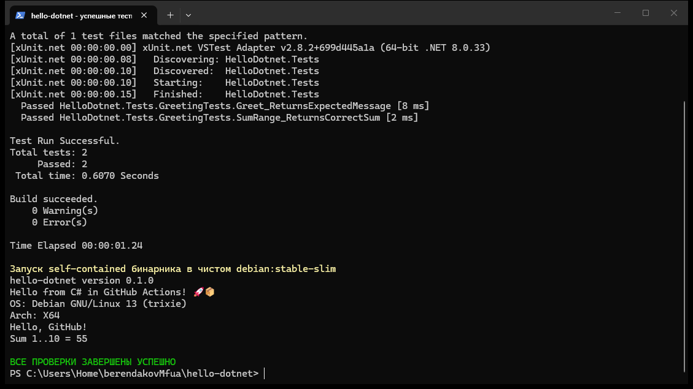
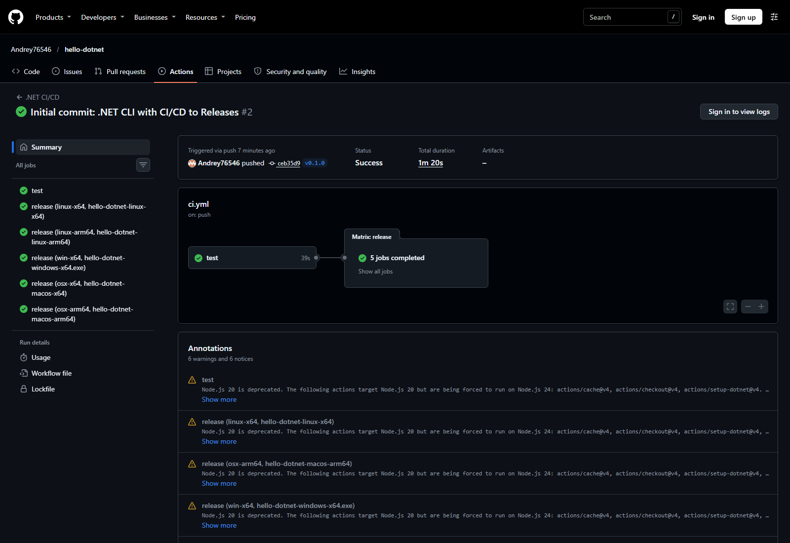
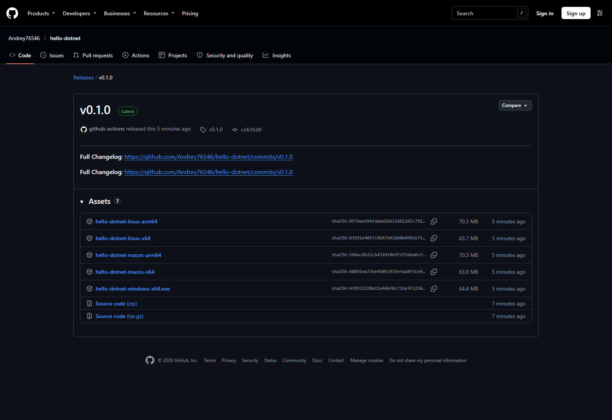

# Лабораторная работа: CI/CD на C#/.NET CLI с публикацией в GitHub Releases

## Цель

Настроить CI/CD для консольного приложения .NET: выполнять форматирование, сборку и тесты, а при публикации тега автоматически создавать пять self-contained исполняемых файлов и прикреплять их к GitHub Release.

Работа выполнена по [инструкции преподавателя](https://github.com/rurewa/imfua/blob/main/content/DevOps/CI_CD/Pipelines/Dotnet.md).

## Использованные технологии

- C# и .NET 8;
- xUnit;
- `dotnet format`, `dotnet build`, `dotnet test`, `dotnet publish`;
- GitHub Actions и матричная сборка;
- self-contained single-file публикация;
- GitHub Releases и `softprops/action-gh-release`.

## Что выполнено

1. Создано CLI-приложение `hello-dotnet` версии `0.1.0`.
2. Реализованы функции `Greet` и `SumRange` и два xUnit-теста.
3. Настроены восстановление зависимостей, проверка форматирования, Release-сборка и тестирование.
4. Release-job зависит от успешного job `test` и запускается только для тегов `v*`.
5. Один Ubuntu runner собирает пять self-contained single-file бинарников.
6. Для тега `v0.1.0` автоматически создаётся GitHub Release с файлами для Linux, Windows и macOS.

## Структура проекта

```text
hello-dotnet/
├── .github/workflows/ci.yml
├── screenshots/
│   ├── 01-tests-and-publish.png
│   ├── 02-github-actions.png
│   └── 03-github-release.png
├── src/
│   ├── Greeting.cs
│   ├── HelloDotnet.csproj
│   └── Program.cs
├── tests/
│   ├── GreetingTests.cs
│   └── HelloDotnet.Tests.csproj
├── .gitignore
└── README.md
```

## Тестирование

.NET SDK на хосте не требуется. Тесты запускаются в официальном контейнере:

```powershell
docker run --rm -e DOTNET_CLI_TELEMETRY_OPTOUT=1 -e DOTNET_NOLOGO=1 -v "${PWD}:/app" -w /app mcr.microsoft.com/dotnet/sdk:8.0 dotnet test tests/HelloDotnet.Tests.csproj
```

Ожидаемый результат: `Failed: 0, Passed: 2, Skipped: 0, Total: 2`.

## Локальная публикация

```powershell
docker run --rm -e DOTNET_CLI_TELEMETRY_OPTOUT=1 -e DOTNET_NOLOGO=1 -v "${PWD}:/app" -w /app mcr.microsoft.com/dotnet/sdk:8.0 dotnet publish src/HelloDotnet.csproj -c Release -r linux-x64 --self-contained true -p:PublishSingleFile=true -p:IncludeNativeLibrariesForSelfExtract=true -o dist/linux-x64
```

Собранный Linux-бинарник можно проверить без установленного .NET:

```powershell
docker run --rm -v "${PWD}/dist/linux-x64:/dist" debian:stable-slim /dist/hello-dotnet
```

## GitHub Actions и Release

Workflow [.NET CI/CD](https://github.com/Andrey76546/hello-dotnet/actions/workflows/ci.yml) запускается при push в `main`, для pull request и для тегов `v*`. Release создаётся только после успешного тестирования тега.

Файлы релиза `v0.1.0`:

- `hello-dotnet-linux-x64`;
- `hello-dotnet-linux-arm64`;
- `hello-dotnet-windows-x64.exe`;
- `hello-dotnet-macos-x64`;
- `hello-dotnet-macos-arm64`.

- Репозиторий: [Andrey76546/hello-dotnet](https://github.com/Andrey76546/hello-dotnet)
- Workflow: [.NET CI/CD](https://github.com/Andrey76546/hello-dotnet/actions/workflows/ci.yml)
- Успешный CI на `main`: [.NET CI/CD #1](https://github.com/Andrey76546/hello-dotnet/actions/runs/41417858502)
- Успешная релизная сборка: [.NET CI/CD #2](https://github.com/Andrey76546/hello-dotnet/actions/runs/41417970176)
- Release: [v0.1.0](https://github.com/Andrey76546/hello-dotnet/releases/tag/v0.1.0)

## Настоящие скриншоты



На снимке показаны реальные локальные тесты и запуск Linux-бинарника в чистом Debian без установленного .NET.



На снимке показаны успешно завершившиеся test и пять матричных release-job.



На снимке показан Release `v0.1.0` и опубликованные файлы для пяти платформ.

## Вывод

Создан автоматический процесс выпуска кроссплатформенного .NET CLI-приложения: каждый релизный тег проходит проверки и превращается в пять готовых исполняемых файлов, доступных в GitHub Releases.
